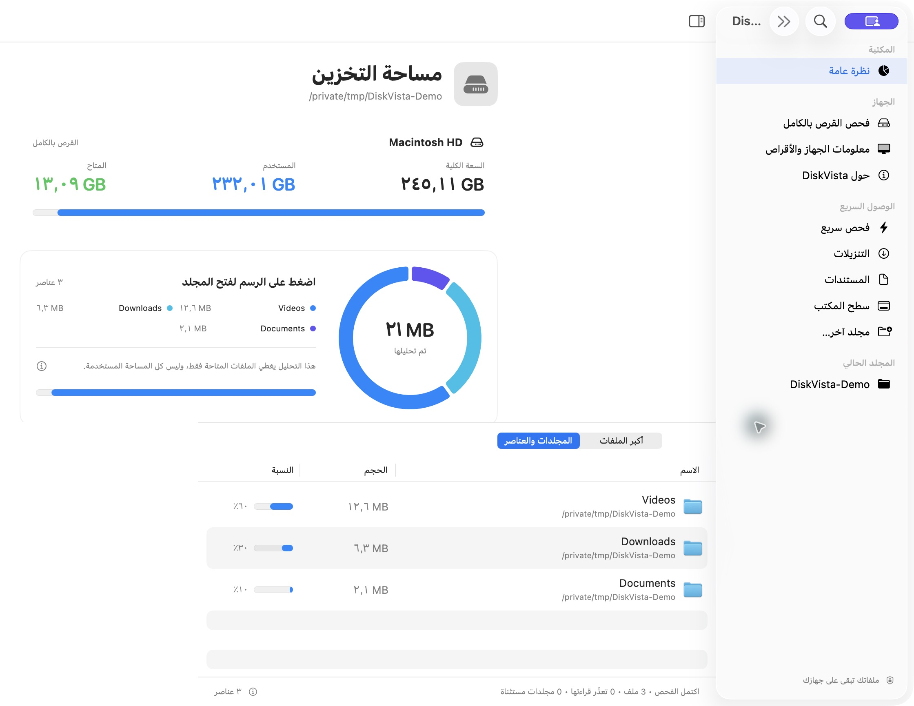
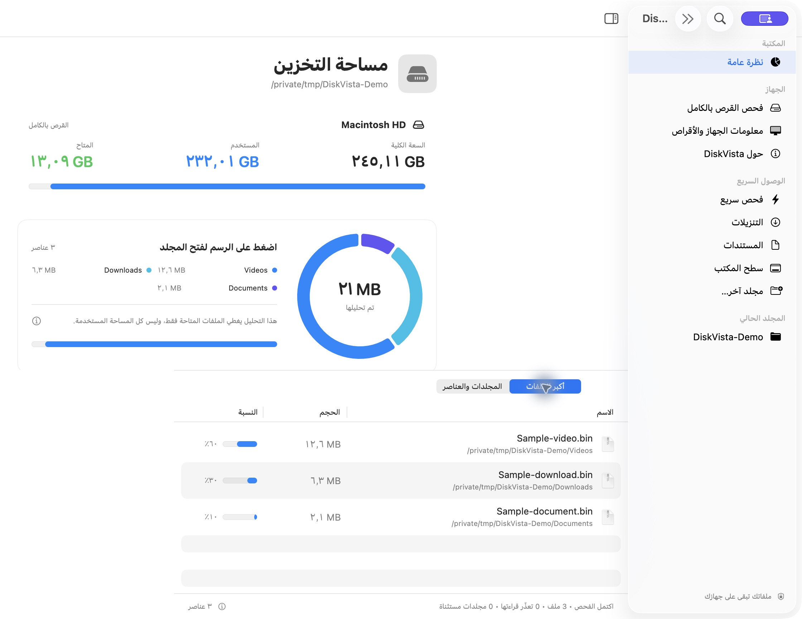

# DiskVista

تطبيق مجاني مفتوح المصدر لتحليل مساحة التخزين على macOS، بواجهة عربية أصلية تتبع مظهر macOS الفاتح والداكن، وشريط جانبي للوصول السريع، ومخطط دائري تفاعلي وجدول لأكبر 500 ملف. يعمل محليًا بلا اتصال بخوادم أو جمع بيانات.

## التحميل والصور

[تحميل نسخة macOS (Apple Silicon)](https://github.com/suliemanalthwab/DiskVista/releases/tag/v0.2.1) · [تحميل المصدر](https://github.com/suliemanalthwab/DiskVista/archive/refs/heads/main.zip)

النسخة الحالية تجريبية، تتطلب macOS 14 أو أحدث، وتحمل توقيعًا محليًا وليست موثّقة لدى Apple بعد. قد يمنع Gatekeeper تشغيلها؛ يمكن بناء التطبيق من المصدر.

صور حقيقية من التطبيق على مجلد عينات تجريبي، دون أسماء ملفات شخصية:





## فكرة التطبيق

DiskVista يساعد مستخدمي الماك على معرفة أين تذهب مساحة التخزين ومراجعة الملفات الكبيرة قبل نقلها إلى سلة المهملات. تظهر سعة القرص والمساحة المستخدمة والمتاحة عند فتح التطبيق، ويبدأ فحص سريع تلقائيًا. الفكرة: سليمان الثواب. البرمجة: Codex.

## المزايا

- واجهة عربية أصلية باستخدام SwiftUI، تتبع المظهر الفاتح والداكن للنظام.
- فحص سريع بنتائج تدريجية، وفحص شامل اختياري مع إرشادات منح صلاحية الوصول الكامل للقرص.
- مخطط تفاعلي: اضغط على الجزء لفتح تفاصيل المجلد، ثم استخدم زر الرجوع للتنقل.
- قائمة بأكبر 500 ملف مع البحث والحجم ونسبة المساحة وإظهار العنصر في Finder.
- معلومات الطراز والمعالج والذاكرة والنظام والأقراص المتصلة.
- تأكيد ومصادقة macOS قبل النقل إلى السلة، مع حماية مجلدات النظام من التنظيف.
- مجاني ومفتوح المصدر بترخيص MIT. [موقع صاحب الفكرة](https://sulieman.my/).

## الخصوصية

تُقرأ أحجام الملفات محليًا؛ لا يرسل التطبيق نتائج الفحص أو معلومات الجهاز إلى خادم. لا يقرأ كلمة مرور النظام ولا يخزنها، ويستخدم نافذة مصادقة macOS. منح صلاحية الوصول الكامل إجراء اختياري ينفذه المستخدم في إعدادات النظام. المصدر لا يتضمن مفاتيح حسابات أو بيانات دخول؛ ملفات الأسرار وملفات البناء مستثناة من Git.

## التشغيل والبناء

يتطلب macOS 14 أو أحدث وXcode Command Line Tools مع Swift 6.

```sh
swift run
# إنشاء تطبيق وملف ZIP للتوزيع
bash scripts/build-app.sh
```

الناتج: `dist/DiskVista.app` و`dist/DiskVista-macOS.zip`. البناء الافتراضي لمعمارية جهاز البناء؛ لإنشاء نسختي Intel وApple Silicon ابنِ لكل معمارية باستخدام SDK مناسب، أو جهز تطبيقًا عامًا واختبره على الجهازين قبل النشر.

## الاستخدام

عند فتح التطبيق تظهر السعة الكلية للقرص والمساحة المستخدمة والمتاحة فورًا، ويبدأ فحص سريع لمجلد المستخدم مع نتائج تدريجية. الفحص التلقائي يتجاوز الملفات المخفية وLibrary وسطح المكتب والمستندات والتنزيلات والصور والموسيقى والأفلام لتقليل طلبات الخصوصية. لإضافة تفاصيل مجلد محمي اختره عبر نافذة اختيار المجلد؛ قد يطلب macOS إذنًا بحسب إعدادات الجهاز. إجمالي القرص مستقل عن مجموع الملفات المفحوصة. ويمكن اختيار قرص متصل. اضغط على الرسم لاستكشاف الأجزاء، وراجع العناصر أو أكبر الملفات. زر المجلد يظهر العنصر في Finder. زر السلة يعرض المسار وتأكيدًا ثم يطلب مصادقة macOS (Touch ID أو كلمة مرور النظام بحسب إعدادات الجهاز). لا يقرأ التطبيق كلمة المرور ولا يخزنها.

النقل إلى سلة المهملات قابل للاستعادة؛ لا تتحرر مساحة القرص حتى إفراغ السلة من Finder. مصادقة المستخدم تؤكد هويته ولا تمنح التطبيق صلاحيات root. التطبيق لا يحذف مجلدات النظام ولا يتجاوز صلاحيات الملفات. إذا مُنع الوصول، راجع أذونات الملفات وإعدادات الخصوصية في macOS؛ قد يحتاج فحص بعض المجلدات إلى Full Disk Access.

## حدود القياس

الأحجام هي المساحة المخصصة للملفات المقروءة، مع استثناء محتويات الحزم في الفحص السريع، وعدم اتباع الروابط الرمزية في كلا الوضعين. ملفات APFS المشتركة والضغط واللقطات والملفات المحمية قد تجعل المجموع يختلف عن إعدادات تخزين macOS. تظهر أخطاء القراءة بعد الفحص. يُحتفظ بأكبر 500 ملف فقط وبإجماليات العناصر المباشرة لتقليل الذاكرة. الفحص يعمل في الخلفية ويمكن إلغاؤه. لا توجد إزالة نهائية أو إفراغ للسلة داخل التطبيق.

## النشر المفتوح

الترخيص MIT يسمح بالاستخدام والتعديل والتوزيع. ارفع المصدر إلى مستودع GitHub عام وأرفق ملف ZIP في Releases. البناء الحالي يحمل توقيعًا محليًا للتطوير فقط؛ للتوزيع السلس عبر Gatekeeper، يلزم توقيع Developer ID ثم notarization باستخدام حساب Apple Developer الخاص بالناشر. لا تضع شهادات التوقيع أو كلمات المرور في المستودع. تتوفر ملفات المصدر في هذا المستودع، ونسخة الماك في صفحة الإصدارات.

## التحقق قبل إصدار عام

جرّب الفحص والإلغاء ومجلدًا محميًا ومجلدًا فارغًا. اختبر الحذف فقط على ملفات تجريبية، وتحقق من إلغاء التأكيد وإلغاء المصادقة والاستعادة من السلة. اختبر أجهزة Intel وApple Silicon عند توفير نسختيهما. هذه نسخة أولية تحتاج اختبار واجهة ومصادقة تفاعليًا قبل إصدارها للجمهور.

اختبار محرك الفحص وقراءة سعة القرص: `python3 scripts/check-scanner.py`.

## الإصدار 0.2

- زر «فحص شامل» يشرح منح Full Disk Access ويفتح إعدادات الخصوصية ويظهر التطبيق في Finder لإضافته. يجب أن يفعّل المستخدم الصلاحية بنفسه، وقد يتطلب النظام إعادة فتح التطبيق. لا يدّعي التطبيق كشف حالة الإذن تلقائيًا.
- الفحص الشامل يبدأ من `/System/Volumes/Data` على macOS الحديث، ويشمل الملفات المخفية ومحتويات الحزم، ويتجاوز نقاط الأقراص الأخرى. الفحص السريع يبقى محدودًا. الأخطاء تظهر في شريط الحالة؛ الوصول الكامل لا يضمن قراءة كل الملفات ولا يشمل لقطات APFS.
- الضغط على قطاع من الرسم أو اسمه يفتح تفاصيل مجلده داخل التطبيق؛ الملف يظهر في Finder. «أخرى» تفتح قائمة بالمجلدات المجمّعة. يوجد زر رجوع.
- «معلومات الجهاز والأقراص» تعرض الطراز والمعالج والذاكرة والنظام والأقراص المتصلة مع سعتها والمساحة المتاحة. وحدات APFS قد تشترك في السعة، فلا تُجمع سعاتها.
- «حول DiskVista»: فكرة سليمان الثواب، برمجة Codex، تطبيق مجاني مفتوح المصدر بترخيص MIT، ورابط https://sulieman.my/.
- الأيقونة في `Assets/AppIcon.png`، وتحويلها إلى ICNS تلقائي أثناء البناء باستخدام أدوات macOS. صُممت بالأداة المدمجة imagegen؛ وصفها: أيقونة macOS زرقاء زجاجية، قرص فضي مع حلقة تخزين سماوية مقسّمة، زوايا شفافة، دون نص. نص التوليد الكامل في `Assets/AppIcon-prompt.txt`.

مرجع الصلاحيات: https://support.apple.com/en-au/guide/mac-help/mchl211c911f/mac
